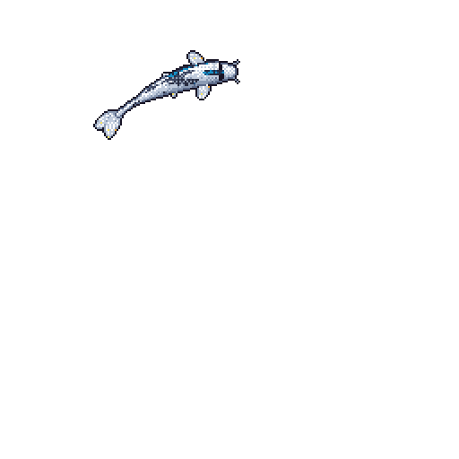

# Hi, I'm Abderrahmane

Second-year Artificial Intelligence engineering student at Xiamen University Malaysia. I build computer vision and rule-based AI projects in Python and C.

## Projects

- **[LegalAudit](https://github.com/mohammedadalachi/legalaudit)**: rule-based expert system that checks Malaysian employment and tenancy contracts against 38 statute-based rules, with OCR and explained findings.
- **[Driver Drowsiness Detection](https://github.com/mohammedadalachi/driver-drowsiness-detection)**: real-time webcam detector using MediaPipe, with a genetic algorithm, KNN, K-Means and a NumPy autoencoder.
- **[Air Draw](https://github.com/mohammedadalachi/air-draw-gesture-drawing)**: draw on screen with hand gestures; strokes snap to clean circles and lines.
- **[Attendance Management System](https://github.com/mohammedadalachi/attendance-management-system-c)**: console app in C that tracks attendance and warns students below 80%.

## Currently learning

Data structures and machine learning fundamentals.

<picture>
  <source media="(prefers-color-scheme: dark)" srcset="snake/snake-dark.svg" />
  <source media="(prefers-color-scheme: light)" srcset="snake/snake.svg" />
  
</picture>

Vegeta 3D model: ["Vegeta From Dragon Ball - Textured and Rigged"](https://sketchfab.com/3d-models/none-41a0b494147e4bf4a3b2b2645d4156c6) by Light.k, licensed [CC BY 4.0](https://creativecommons.org/licenses/by/4.0/). Dragon Ball characters belong to Akira Toriyama and Toei Animation.
